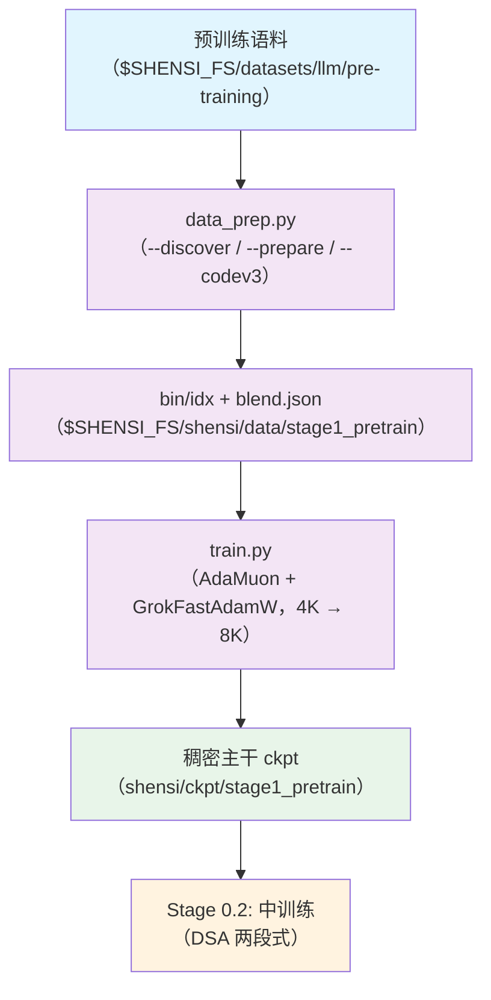

# Stage 0.1: 主预训练（稠密主干）

预训练第一段：用短序列把主干训起来，**不引入 DSA**（`csa_dense_mode: true`，Lightning Indexer 不参与），
27T 语料量级（= 2950 token/总参数；文献口径见下「8 卡容量与吞吐账」）。DSA 与长上下文在 [`../stage2_midtrain`](../stage2_midtrain/README.md) /
[`../stage3_longctx`](../stage3_longctx/README.md) 引入。

## 总览

| 组件 | 做什么 |
|------|--------|
| `train.py` | 入口：`--profile` / `--config` 选档、`--smoke`、`--tokens` 按预算换算 `train_iters`、`--set` 覆写 |
| `test_train.py` | 集成测试：tiny 几何 + 本档，5 步判 PASS/FAIL |
| `data_prep.py` | 语料 → mcore `.bin/.idx` + `blend.json`（`--discover` / `--prepare` / `--codev3`） |
| `config/` | `default.yaml`（全量）+ `tiny.yaml`（冒烟）+ `debug.yaml`（极小）+ 五个优化器对照档 |
| `config/data_prep/` | `data_blend_raw.json` / `data_blend_tiny.json` + `default.yaml` / `tiny.yaml` |

| 项 | 结论 |
| --- | --- |
| 目标 | 稠密主干收敛到可做中训练的底座；序列 4K 起步、收尾拉到 8K |
| 关键决定 | 优化器用 **AdaMuon（矩阵腿）+ GrokFastAdamW（标量腿）**，两条腿共用一条 LR 曲线（峰值 2.7e-4） |
| 验收 | 集成测试 5 步 PASS + ckpt 存续往返（含优化器状态）+ 参数路由 / 分裂 / 状态键逐项核对 |

## 快速开始

```bash
python test_train.py                    # 集成测试：tiny 几何 5 步（没准备语料就退回 mock）
python data_prep.py --discover          # 语料面貌（列名 / 条数 / 权重）
python data_prep.py --prepare           # → $SHENSI_FS/shensi/data/stage1_pretrain/{*.bin,*.idx,blend.json}
python train.py --profile tiny          # 冒烟：tiny 几何 + mock 数据 + 5 步（等价 --smoke）
python train.py --profile debug         # 真实语料的极小档（单卡 5 步）
python train.py --tokens 27e12          # 正式跑（27T = 2950 token/总参数）
```

`--profile tiny` 是 mock 档（不碰语料）：即使 `$SHENSI_FS/shensi/data/stage1_pretrain/blend.json` 已经存在，
也不会被注入 `data_path`（mcore 要求「mock / data-path / data-args」三者恰好给一种）。

`train_iters` 用 token 预算换算：`--tokens 27e12` → `iters = tokens / (global_batch_size × seq_length)`；
同时把 `lr_decay_iters` 钉在这次预算上，之后放大 `train_iters` 不会拉长 LR 余弦退火。

## 数据准备

### Pipeline

1. `--discover` → 语料根 + 各数据集的列名 / 条数 / 权重；
2. `--codev3`（按需）→ 只有元数据的代码集先回捞文本（本段配比里它默认被 `--prepare` 跳过）；
3. `--prepare` → 编码成 `.bin/.idx` 并写 `blend.json`。

### CLI 命令

```bash
python data_prep.py --discover | --prepare [选项]
```

| 选项 | 说明 |
|------|------|
| `--discover` / `--prepare` | 只扫描并打印语料面貌 / 产出 `.bin/.idx` 与 `blend.json` |
| `--config <档>` | 数据准备档（`config/data_prep/{default,tiny}.yaml`） |
| `--blend <json>` | 换一份配比（默认 `config/data_prep/data_blend_raw.json`） |
| `--limit N` / `--only <子串>` | 每个数据集最多取 N 条 / 只处理名字含子串的数据集（冒烟用） |
| `--root` / `--out` / `--tokenizer` | 语料根 / 产物目录 / tokenizer 目录（默认取环境变量） |
| `--workers N` | 并行度（默认 32） |
| `--skip-missing` | 语料没齐时跳过缺的数据集（默认遇到缺的就停下报错） |
| `--include-metadata-only` | 把「只有元数据」的数据集当硬报错（提醒先回捞文本） |
| `--codev3` + `--hf-sample N` | 回捞元数据类数据集的文本；配套 `--only-new` / `--only-carried`（增量 / 已有部分）、`--v1-meta` / `--v2-meta` / `--v3-meta`（本地元数据）、`--text-cache`（命中就不回捞）、`--min-chars` / `--max-bytes`（落地阈值） |

### 输入

- 语料根 `$SHENSI_FS/datasets/llm/pre-training/`；
- `config/data_prep/data_blend_raw.json` 是可直接使用的预训练配比（web / code / math / specialized /
  SFT 合成 / legal），权重和 = 1.0；域的构成与权重见 [`../README.md`](../README.md#数据准备)；
- 极小档用 `config/data_prep/data_blend_tiny.json`；tokenizer 可以是自训的小 tokenizer（`SHENSI_TOKENIZER=<dir>`）。

### 输出

`$SHENSI_FS/shensi/data/stage1_pretrain/`：

```
<数据集>__<config>_text_document.bin / .idx   # 一篇文章一条样本 + 尾部 EOD
<数据集>__<config>.jsonl                      # 编码前的中间文本（便于回查）
blend.json                                    # 权重 × 前缀（交错），train.py 自动注入 data_path
```

只有元数据的数据集（Code-v3）在 `--prepare` 时明确跳过，先跑 `--codev3` 落地文本（见
[`../README.md`](../README.md#数据准备) 的 Code-v3 一节）。

### 配置

| 文件 | 说明 |
|------|------|
| `config/data_prep/data_blend_raw.json` | 生产配比（权重和 = 1.0） |
| `config/data_prep/data_blend_tiny.json` | 冒烟配比 |
| `config/data_prep/default.yaml` | 准备档：`root` / `out` / `tokenizer` / `workers` / `split: 98,1,1` / `append_eod` / `limit` |
| `config/data_prep/tiny.yaml` | 极小档准备口径 |

## 训练

### CLI 命令

```bash
python train.py [选项] [--set k=v ...]
```

| 选项 | 说明 |
|------|------|
| `--profile <档>` / `--config <路径>` | 选档（两者等价，例：`--config config/tiny.yaml`） |
| `--smoke` | 跑仓库内 tiny 配置 5 步 |
| `--tokens N` | 按 token 预算换算 `train_iters`（`27e12` = 正式跑 = 2950 token/总参数） |
| `--data-dir <目录>` | 预处理产物目录（含 `blend.json`） |
| `--set k=v` | 点号键覆写，可多次 |
| `--dry-run` | 只打印命令，不启动 |
| `--early-stop N` / `--no-early-stop` / `--early-stop-grace S` | 早停耐心（默认 3）/ 关掉 / 宽限秒数（默认 600） |

### 输入 / 输出

- **输入**：`$SHENSI_FS/shensi/data/stage1_pretrain/` 下的 `bin/idx + blend.json`；本段从头训
  （`experiment.load: null`），要续训就 `--set experiment.load=<ckpt>`；
- **输出**：`$SHENSI_FS/shensi/ckpt/stage1_pretrain`（`torch_dist`；**全量档是纯权重**——8 卡走
  precision-aware 优化器，状态存不了，见「局限」；下段 `stage2_midtrain` 的 `dsa_warmup` 默认接它）。

### 关键配置

| 项 | 值 |
| --- | --- |
| 序列长度 | 4096（主体）→ 8192（收尾，`--set train.model.seq_length=8192`） |
| 全局批 | `global_batch_size: 128`（= micro_batch × DP，按卡数调） |
| 优化器 | AdaMuon（矩阵腿）+ GrokFastAdamW（标量腿），wd 0.1、grad clip 1.0 |
| 学习率 | 2.7e-4 → 2.7e-5，warmup 3%，cosine；两条腿共用 |
| 并行 | EP=8、TP=1、PP=1、CP=1、distributed optimizer + overlap；生产档 `no_use_layer_wise_param_layout: true` |
| 精度 | bf16 + attention softmax fp32 + allreduce 累加 fp32 |
| MTP | 全量档 `mtp_num_layers: 3`；极小档几何由 `tiny_model.TINY` 注入、MTP 默认 0，要试 `--set train.model.mtp_num_layers=1` |
| loss | aux 0.001 + ERC 1.0/0.5（本段 indexer KL 为 0） |
| 深度连接 | GDAR（AttnRes 的读写）：四门合成一个 `g_scale(4)`（初始 0 → init 精确等于 `prefix + delta`）；`t` 是可学逐通道 log 时间常数；写是 gated delta rule 的闭式解；读 = 白化打分 + Softmax₁；投影是低秩具名对（秩 = `routed_expert_hidden_size`） |

### 优化器

| 参数 | 走哪条腿 |
| --- | --- |
| 2D 矩阵（attention q/kv/o、MLA 的 `linear_q_up_proj` / `linear_o_group_proj`、MoE 专家、latent 投影） | **AdaMuon**：Newton–Schulz 正交化 + 每参数谱尺度 + 第二矩自适应；`muon_split_qkv` 拆 q/kv，再叠加 MLA 的按头（q_up）/ 按组（o_group）切分 |
| embedding / 输出头 / norm / MoE router / mHC 静态与 AttnRes 门控 / 哈希嵌入 / 压缩器位置表 | **GrokFastAdamW**（梯度低通滤波 + AdamW；单换标量腿：`--set train.model.optimizer.muon_scalar_optimizer=ademamix`，整模型 AdEMAMix 见 `--profile ademamix`） |

关键旋钮：`muon_extra_scale_factor: 0.18`（把更新幅度归一到 Adam 系量级，两条腿共用一条 LR）、
`muon_scale_mode: spectral`、`muon_nesterov: true`、`muon_coefficient_type: polar_express` +
`muon_num_ns_steps: 5`、`muon_tp_mode: distributed`；标量腿的 `grokfast_alpha` / `grokfast_lamb`（滤波的
`after_step` 用库默认）。
**不启用 QK-clip**：`qk_layernorm: true` 已把 q/k 归一化。

对照档：`ademamix`（整个模型用 AdEMAMix）、`muon`（quintic + blockwise）、`adamw`、`lion`（旧口径 Muon + Lion）——
原 `grokfast` 档已并入默认档（默认口径就是 AdaMuon + GrokFastAdamW）。六档的同预算对照读数（极小几何
20 步）见 [配方 README 的「优化器」一节](../../README.md#优化器)：Muon 家族 `lm loss` 5.75~5.87
（`muon` / 「换口径前」两行是换口径前实测），AdamW / Lion / 单 AdEMAMix / 旧口径（Muon + Lion）6.23~6.47；
跑法 `python test_train.py --profile <档> --iters 20`。

### 覆写示例

```bash
python train.py --set train.model.global_batch_size=256        # 改超参（按卡数与显存调）
python train.py --set train.model.seq_length=8192              # 收尾拉长序列
python train.py --profile muon --set experiment.load=<ckpt>    # 换优化器对照档 / 从 ckpt 续

# 8 卡全量档：加 precision-aware 优化器（省显存；它撑住"跑得动"，代价是状态不落盘，见「局限」）
python train.py --set train.system.use_precision_aware_optimizer=true

# 从纯权重 ckpt 续跑：显式跳过优化器状态（入口见到 ckpt 旁的 pure_weight.json 会点名这条）
python train.py --set experiment.load=<ckpt> --set train.system.checkpoint.no_load_optim=true
```

## 验证

1. **参数路由不变量**：2D 非标量参数在 AdaMuon 那条腿，embedding / 头 / 1D / 名单在标量腿（GrokFastAdamW）；
2. **MLA Muon Split**：`linear_q_up_proj` 按头切开、`linear_o_group_proj` 按组切开；
3. **两条腿共用一条 LR**，AdaMuon 侧幅度由 `muon_extra_scale_factor` 归一；
4. **训练健康**：loss 有限且两条腿都更新；optimizer state（`exp_avg` / `exp_avg_sq` / `grok_exp_avg` /
   `momentum_buffer`）齐全；
5. **可续训**（**单卡 16G 口径**）：极小档 10 步、第 5 步存（含优化器状态）→ 从 `iter_0000005` 载入接着训到 10
   （`successfully loaded checkpoint ... at iteration 5`、`Traceback=0`）；现在默认档统一纯权重
   （`no_save_optim: true`），复现这条要 `--set train.system.checkpoint.no_save_optim=false`；纯权重
   续跑给 `--no-load-optim`（见「局限」）；
6. **集成测试**：`python test_train.py` 5 步 PASS（**要真 Transformer Engine**：模型走 HybridModel +
   DSv4-hybrid 注意力，本机没有 TE 时会在建 `DSv4HybridSelfAttention` 的 TE 层时停下——四个 stage 的
   冒烟本机都只停在这一处，说明「解析 → 几何对拍 → hybrid 配置 → 容器 → set_run_config → 建模型」
   这条链是通的）；
7. **构造器契约**（本机可跑）：`common/train/test_builders.py` —— 钉住 `ShensiModelBuilder` 走 Bridge 的
   `build_shensi_model`（hybrid_stack_spec + hybrid_layer_pattern）、不再传旧式的
   `transformer_layer_spec`/`mtp_block_spec`，并核出默认几何的层计划 `*×19 + /*`。

本机实测：200 步极小档（`--no-early-stop`，`train_iters=200`）loss 6.47 → 3.38，单步中位 241 ms，0 skipped / 0 NaN；冒烟 5/5 步（loss 4.91 → 4.45，日志里能看到标量腿旋钮挂载与接入行）；`--profile debug` 5/5 步
存 `pt_tiny_debug/iter_0000005`；参数分组 / 分裂 / 状态键逐项核对通过。

## 8 卡容量与吞吐账（9B 档实测 2026-10-10；新默认几何的静态账见节末）

单位口径：mcore 打印的 “(MB)” 是 10⁶ 字节，torch 报的 “GiB” 是 1024³——**1 GiB = 1073.74 MB**。
此前按 1024 混算得到的“峰值余量 8.8 GiB”是错的，正确值约 **12.3 GiB**。

| 项（每卡，iteration 20 存盘前打印） | 原始读数 | 换算 | 性质 |
|---|---|---|---|
| 稳态 `allocated` | 29034.89 MB | 27.0 GiB | 实测 |
| 峰值 `max allocated` | 52209.01 MB | 48.6 GiB | 实测 |
| `reserved` | 55932.00 MB | 52.1 GiB | 实测 |
| 卡总量 | — | 60.96 GiB | 实测 |
| **峰值余量** | — | **~12.3 GiB** | 实测 |

静态部分（可推导，与实测稳态吻合）：每卡本地参数 4.75B = 专家 5.03B / 8 = 0.63B ＋ 非专家 4.12B
（**每卡一份、不切分**；非专家占总参数 45%）：

| 项 | 算法 | 大小 | 来源 |
|---|---|---|---|
| bf16 权重 | 4.75B × 2 B | 8.84 GiB | 推导 |
| fp32-keep 额外 | ~0.5B 参数由 bf16 改 fp32（估） | +0.9 GiB | 估算 |
| `main_grads`（bf16） | 4.75B × 2 B | 8.84 GiB | 推导 |
| 优化器动量（`exp_avg` + `exp_avg_sq`，bf16） | 上界 4.75B × 4 B = 17.7，按实测反推 | ~9–10 GiB | 反推 |
| **静态小计** | | **≈27–28 GiB**（与实测稳态对上） | |

动态部分（峰值 − 稳态 = 21.6 GiB）：优化器步瞬时（flat-buffer 切片、梯度范数归约、HCCL 规约缓冲）
为大头——两次 OOM 的栈都落在这里（420 MB HCCL 缓冲、3.13 GiB 分配）；MoE dispatch/combine 与
grouped GEMM 工作区次之（EP=8 每层两次 all-to-all × 38 层）；重算工作区最小（`full/uniform/35`
只存整段一个检查点，激活存储已是最低）。

**主因排序**：非专家参数每卡冗余（45% 参数 × 8 字节/参数）＞ 优化器动量 ＞ 每步瞬时块 ＞ 激活——
**激活是最小项**，所以“降 seq 换显存”收益有限，“换并行切法”收益最大：

| 手段 | 静态变化 | 代价 |
|---|---|---|
| `TP=2 × EP=4`（8 卡） | 每卡参数 4.75B → ~3.3B，静态约 −8 GiB（头寸 12.3 → ~20 GiB） | 每层多一组 TP all-reduce |
| 单状态优化器（Lion） | 动量减半 ≈ −9 GiB | 训练方法学变更 |
| `expandable_segments`（已用） | 不改占用、只治碎片 | 已生效，是当前能跑的原因 |

**新默认几何（2.78B / 1.24B 激活）的静态账（同口径推算）**：

- 默认档 EP=8×DP=1：每卡参数 = 专家 1.57B/8 ＋ 非专家 1.20B = **1.40B** → bf16 权重 2.6 ＋ `main_grads` 2.6 GiB；
  优化器状态 DP=1 不分片——precision-aware（bf16）≈5.6 GiB，非 precision-aware（fp32 主权重 5.6 ＋ 动量 11.2）
  ≈16.8 GiB，**两条都装得下**（静态合计 ≤22.5 GiB，余量 38 GiB+）；
- `scale8` 档 EP=1×DP=8：每卡参数 2.78B（专家全份）→ 权重 5.2 ＋ grads 5.2 ＋ 分布式优化器状态按 DP=8 分片
  ≈1.4–2.8 GiB → 静态 ≈12–13 GiB。

结论：新几何下**显存不再是约束，吞吐才是**；而且优化器状态存盘那条限制（见「局限」4）在 8 卡上有解——
标定后去掉 precision-aware 就能拿回全状态 ckpt。

吞吐基线（9B 档实测）：seq 64 × gbs 8（512 token/步，配置口径微批 1 × 累积 8）14.9 s/步 ≈ **34 token/s**（全 8 卡，
按 910B2 bf16 约 376 TFLOP/s/卡算约 0.03% MFU）。这个量级下每步被“38 层 × 2 次 all-to-all ＋ 优化器
瞬时块”的发射延迟主导——**同样的 token/步摊进一个微批**（长 seq × 微批，而不是短 seq × 累积）能直接
把发射次数除下去，是零成本的第一个吞吐实验。

量级结论（默认几何，换算：每卡 30% MFU ≈ 1.51 万 token/s、8 卡 12.1 万）：计划的 27T token 是**集群级**
计划——8 卡即便按 30% MFU 也只有 12.1 万 token/s（1T token ≈ 96 天、27T ≈ 7 年），9B 档实测的 34 token/s
下 1T 是 950 年量级。所以本机的正确产出不是“训了多少 token”，而是把配方在多卡上跑通、把吞吐曲线与
显存底数测准，让“卡数 × 时间 × token”那张表成立——**并且默认几何把“一周 ≥Chinchilla”真正放进了这张表**
（5.4–8.2 天，见「一周训完」一节）。

**“训练收敛”的验收线**（模型已按 `common/config/hf/2p8b_a1p2b.json` 核算：总参 **2.7774B** / 激活 **1.2414B**，
专家占 57%）。先摆文献口径——每参数多少 token（t/p）有三条公认线，再据此定档：

- **计算最优 ≈ 20 t/p**（Chinchilla，[arXiv:2203.15556](https://arxiv.org/abs/2203.15556)）：按总参 2.7774B →
  **~55.5B token**；按激活 1.2414B、照细粒度 MoE 的计算最优表（[arXiv:2402.07871](https://arxiv.org/abs/2402.07871)：
  最优 D ≈ 20–30 × 激活参数）→ **25–37B**。
- **推理导向的“训完”带宽 1000–4500 t/p**：Llama-3-8B（15T / 8B = **1875**）、Qwen3（36T 预算，8B 档 ≈ **4500**）；
  集群级参照 GLM-5（27T / 744B = 36 t/p 总参 = 675 t/p 激活）——**本档 8 卡一周的 48.9–73.3B token 按总参 =
  17.6–26.4 t/p，正落在 Chinchilla 线上**（把 27T 计划搬到 2.78B 是 9722 t/p，那是集群账，8 卡要 ~7 年；
  DeepSeek-V3 是另一端：22 t/p 总参 = 400 t/p 激活，大模型靠 MoE 稀疏省推理，不必那样过训）。
- **没有饱和点**：推断感知缩放律（[arXiv:2401.00448](https://arxiv.org/abs/2401.00448)，47 个模型、10–10⁴ t/p）
  没看到 loss 饱和——“模型级收敛”不是 token 能定义的：定义它的是**服务量**（→1000+ t/p）或**算力**（→20 t/p）。
  另有过训伤下游微调的告警（Overtrained Language Models Are Harder to Fine-Tune，2025）——本配方是
  预训练 + SFT + RL 三段，27T 的过训要连下游一起评。

| 档 | 口径 | token 预算（2.78B / 1.24B 激活） | 8 卡（30 天所需吞吐 → 可行性） |
|---|---|---|---|
| A 链路稳定 | 工程验收（无文献锚） | 10M–1B | 4–390 t/s ✓ 现在就够（10M @34 t/s = 3.4 天） |
| B 缩放对齐 | 0.1–1 t/p（loss 仍在陡降段） | 0.3–2.8B | 116–1,080 t/s ✓ 同 seq 下微批 × 累积 A/B 就能到 |
| C 预算内收敛 | 本段 cosine 走完、loss 随 LR 落底变平（相对收敛） | 2.8–5.6B | 1.1k–2.2k t/s ✓ 大微批一档就够 |
| D 计算最优 | 20 t/p 总参（或 20–30 t/p 激活）= Chinchilla 前沿 | 25–55.5B | 9.6k–21.4k t/s ✓ **落在 20–30% MFU 的现实带宽里**（5.3–7.9 天） |
| E 推理口径训完（GLM-5 参照 27T 在此带） | 1000–4500 t/p：Llama-3-8B 1875 / Qwen3-8B 4500 | 2.8–12.5T | ✗✗ 集群级（500B ≈ 13 卡×30 天、1T ≈ 26 卡×30 天） |

所以 8 卡现在买的是 **A–D 四档**（默认几何把 D 从“超天花板”拉进了射程），E 是算力账单——②③④ 给的是
B–D 的实际带宽：若固定成本落在“每微批”上，把 32k token 摊进一个微批就可能一步拿到 6–12 万 t/s
（15–30% MFU），D 档（55.5B = Chinchilla）就是 5.3–7.9 天。

## 8 卡正式配方（默认几何 2.78B / 1.24B 激活，`--profile scale8`）

前提：**几何就是 `common/config/hf/2p8b_a1p2b.json` 这一份，一个字段不改**；8 卡上能调的全在训练侧——并行
切法、token/步与批、token 预算、LR 与调度、数据、跑哪些 stage。物理约束见上节：每 token
6 × 1.2414e9 = 7.448 GFLOP，8 卡（3.0 PFLOPS bf16）100% MFU ≈ 40.4 万 token/s，15% MFU ≈ 6.1 万、5% ≈ 2 万
token/s；9B 档实测的 34 token/s 是发射主导（0.03% MFU），②③④ 三个实验就是把它抬上来的。

| token 预算 | t/p（总参） | @10k t/s | @30k t/s | @80k t/s（20% MFU） | @121k t/s（30% MFU） |
|---|---|---|---|---|---|
| 10B | 3.6 | 11.6 天 | 3.9 天 | 1.4 天 | 1.0 天 |
| 30B | 10.8 | 34.7 天 | 11.6 天 | 4.3 天 | 2.9 天 |
| 55.5B（Chinchilla 线） | 20 | 64.2 天 | 21.4 天 | 8.0 天 | 5.3 天 |
| 73.3B（一周 @30% MFU 上限） | 26.4 | 84.8 天 | 28.3 天 | 10.6 天 | 7.0 天 |

结论（8 卡版正式配方）：**目标 ≥ Chinchilla——唯一语料 19B × 3 epoch = 57B token-passes（一周的上限
= 19B × 3.8 ≈ 73B）**，路线就是“精选 + 合成 + 蒸馏 + 重复”把每个 token 用到最满；57B passes 在 20–30%
MFU 下 = **5.4–8.2 天**，这就是“一周 + 可发布”的正式目标位。这不是“验证跑”——是一条能在 8 卡上走完的
正式链路，里程碑：

| 阶段 | 预算 | 工期（@30% MFU / @20% MFU） |
|---|---|---|
| 吞吐标定（`scale8` → `thru` + 杠杆） | — | 1–2 周 |
| 数据（Curator 重筛 + DataDesigner 合成 + 打包） | 唯一 19B | 与标定并行 |
| PT（cosine 走完） | 57B passes（唯一 19B × 3 epoch） | 5.4 / 8.2 天 |
| 中训练（DSA 引入） | 3B | 7 / 10 小时 |
| SFT（指令 + 蒸馏数据） | 1B | 2.3 / 3.4 小时 |
| 导出 + `stage3_eval` 出分 | — | 1 小时 |

质量预期要说清：t/p（激活）= 46（57B / 1.2414B）对比智谱 GLM-5 的 675、Qwen3-8B 4500——**这是“能给分、
与同预算公开模型可比”的 2.8B，不是大厂同级**；它验证的是“配方 + 数据 + 并行”在 8 卡上的完整闭环，
以及一张可信的规模账。

**别人实测的锚（决定"收敛可发布"长什么样）**：

| 模型 | 规模 | token 预算 | 硬件 / 工期 | t/p | 结果 |
|---|---|---|---|---|---|
| phi-1（Textbooks） | 1.3B | 7B（6B 筛过网页 + 1B 合成）× 8 epoch | **8×A100 × 4 天** | 5.4（含 8 epoch ≈ 43） | HumanEval 50.6%，已发布、被广泛引用 |
| phi-1.5 | 1.3B | 30B（80% 合成） | 32×A100 × 8 天 | 23 | 发布模型卡 + 评测 |
| Chinchilla 最优的 TinyLlama | 1.1B | 22B | **8×A100 × 32 小时** | 20 | 论文里给的复现口径 |
| TinyLlama（完整） | 1.1B | 3T | 16×A100-40G × 90 天 | 2730 | 56% MFU/卡，1.1B 级里公开最强之一 |
| Llama-3-8B / Qwen3-8B | 8B | 15T / 36T | 大集群 | 1875 / 4500 | 现代"发布即过训"带 |
| DeepSeek-V3 | 671B/37B 激活 | 14.8T | 大集群 | 22（总参） | MoE 靠稀疏省推理，不走小模型过训 |

两条结论：① **8 卡上“发布级”的先例全是 phi 路线——1–1.3B 模型 + 7–30B 高筛选/合成 token，
4–8 天训完，然后评测发布**；本档就是这条路线的放大版：2.78B + 57B passes（19B 唯一 × 3 epoch）、
5.4–8.2 天、正好压在 Chinchilla 线上（20.5 t/p，比 phi-1.5 的 23 t/p 还保守，重复也少于 phi-1 的 8 epoch）；
② 反例是 9B 级：**没有 9B 级模型在 10–30B token（t/p 1–3）上发布过**——9B 几何要发布得走完整的
Chinchilla 线（183B passes = 2.4–3.9 个月），一周不够。这不是估算，是上表这些人实际做出来的数字。

**吞吐能优化到极限吗——能，而且量级算得出来**。这台机 8 卡的算力上限（100% MFU，默认几何）≈ **40.4 万
token/s**；TinyLlama 那种调法（56% MFU/卡）在本机对应 30% MFU ≈ **12.1 万 token/s**；默认几何（1.24B 激活）
现实目标位 **15–25% MFU ≈ 6.1–10.1 万 token/s**。9B 档实测 34 token/s（= 其上限的 0.03%）的病灶很具体：
**微批只有 64 token（seq64 × mbs1 × 累积 8）**——每个算子都在 latency/带宽区，8 次累积再把开销乘 8。
改法分两层，**都已经落成可跑的档**：

**① 批的形状**（default 已是 mbs 8 × DP 8 × 累积 4 = 1.05M token/步，`--profile thru` 把微批再抬到 64k）；
**② 模块的精度路径**——审计模型代码发现的主因级浪费：`hc_fp32_keep`（默认 True）让 mHC 与 AttnRes
这两族模块（每层 4 个 × 19 层 = 76 个）走 **fp32 GEMM + 每次调用 cast 权重与激活**（mHC 一次
`flatten().float()` 就是 1.3→2.6 GiB），而模型其余部分都是 TE 的 bf16 融合内核——`thru.yaml` 已把
`no_shensi_hc_fp32_keep: true` 打开（bf16 GEMM + fp32 累加；要跑 HF↔mcore 逐位对拍时再注释掉）。

杠杆表（按预期收益；标定台一条命令全测）：

| # | 杠杆 | 预期 | 怎么验 |
|---|---|---|---|
| ① | 微批 64 → 32k token（`thru`） | **主杠杆，100× 量级** | `bench_throughput.py --points base,thru_fp32` |
| ② | **fp32-keep 关掉**（mHC/AttnRes 换 bf16，`thru.yaml` 已开） | 2–5×（那 76 个模块的业务量占比） | `--points thru_fp32,thru_bf16` |
| ③ | 累积 4 → 1（同 token/步） | 1.2–2× | 同 seq 下 accum 扫描 |
| ④ | 布局 EP=8（专家切卡，省每卡 ~2.7 GB 静态） | 量出来才知道（代价 = 每层两次 all-to-all） | `--points ep8`（与 `thru_*` 的 EP=1 对照） |
| ⑤ | TE 融合（梯度累积融合等） | 1.1–1.5× | 逐条开（grouped GEMM **默认已开** ✓） |
| ⑥ | 重算档位 / ⑦ HCCL env | 各 1.1–1.3× | 显存有余量 / env 扫描 |

**标定台**：`python -m shensi.recipes.shensi.common.train.bench_throughput --steps 20` —— 一条命令把
`base`（对照）/ `thru_fp32` / `thru_bf16` / `ep8` 四点各跑 20 步，解析日志出 **token/s、每卡 TFLOP/s、
MFU** 表（落 `bench_throughput.json`）；本机可先 `--dry-run` 看四点命令（已核：fp32-keep 的开关只
出现在该出现的两点）。四点跑完，那张“5.4–8.2 天”就有实测支撑；若 `thru_bf16` 把 token/s 顶到 8–12 万，
Chinchilla 线（57B passes）就是 5.4–8.2 天。

**token 预算（8 卡版）：目标 ≥ Chinchilla**——智谱按**激活参数**算数据（GLM-5：27T / 40B 激活 =
675 t/p 激活），但那是集群账：8 卡优化吞吐后一周只有 48.9–73.3B token-passes。所以正式目标是
**≥ 55.5B token-passes（总参 20 t/p = Chinchilla 下限；本档取 57B）**，用“唯一语料 × 多 epoch”凑齐
（mcore 的 dataset 多 pass 时按 epoch 重排；数据受限缩放律说 ≤4 epoch 的重复几乎不损失，Muennighoff 2023）：

| 口径 | 唯一语料 | epoch | token-passes | t/p（总参/激活） | 8 卡工期（@121k / @81k t/s） |
|---|---|---|---|---|---|
| **本档目标：Chinchilla 线** | **19B** | **3** | **57B** | 20.5 / 46 | 5.4 / 8.2 天 |
| 上限（重复≈免费区，一周 @30% MFU） | 19B | 3.8 | 73B | 26.4 / 59 | 7.0 / 10.5 天 |
| 更多样（可选） | 28B | 2 | 56B | 20.2 / 45 | 5.4 / 8.0 天 |
| GLM-5（参照，非 8 卡可及） | 27T | 1 | 27T | 9722 / 21750 | ~7 年 ✗ |

选 19B 唯一（而不是 28B/56B 跑一遍）是因为它把 Curator 的筛选量砍到 1/3，重复的代价在 ≤4 epoch 内很小。
19B 的建议构成：精选网页/代码/数学 13–14B + 教材式合成（DataDesigner）3–5B + teacher 蒸馏
（stage3_opd 链路）1.7–3B。**预算更大的档**（8 卡能连跑 3–6 周时）用
`--config config/data_prep/formal.yaml`：唯一 60B × 3–4 epoch = 183–240B passes = 66–88 t/p（总参），
17.5–34 天。

流程（跑完直接 train）：

```bash
# ① 上游重筛（CUDA 机器或 Curator CPU 路径）：语言 ID → 质量 → MinHash/LSH 去重 → PII
# ② 合成/蒸馏：DataDesigner 教材式数据；teacher 蒸馏走 stage3_opd 链路（按 blend 条目 weight 掺入）
# ③ 预算化打包（本仓；入库前最后一道轻筛 + 按权重扣预算）：
python data_prep.py --config config/data_prep/week_2b.yaml --prepare     # 唯一 19B 档
# ④ 直接开训：train 自动把 blend.json 的「权重 × bin 前缀」注入 data_path
python train.py --tokens 5.7e10      # 3 epoch = 57B passes（≥Chinchilla@2.78B = 55.5B）；一周上限 ~7.3e10
```

打包落 `budget_report.json`（每源目标 / 实到 / 丢弃原因）；`common/test_data_prep.py` 是本机闸门
（预算分配、质量门、去重、bin/idx 与 blend 产物、train 侧读入，6/6 过）。峰值 LR 与 warmup：
cosine 横轴 = 总 passes（`--tokens` 自动设 `lr_decay_iters`），warmup 建议从 3% 降到 1%
（1.9B token ≈ 4.4 小时 @121k t/s），峰值按 3 点 pilot 定。

### 一周训完：默认几何（2.78B）正好落在线上

8 卡的物理上限（20–30% MFU，7.448 GFLOP/token）：**一周 ≈ 48.9–73.3B token @2.78B（默认几何）、
45–150B token @0.6–2B、10–20B token @9B**。默认几何让“一周 + ≥Chinchilla”第一次同时成立；9B 要
Chinchilla 线得 2.4–3.9 个月：

| 方案 | 一周能给的数据 | t/p（总参） | 结论 |
|---|---|---|---|
| **默认几何 2.78B（`--curate-scale week_2b`，推荐）** | PT 57B（唯一 19B ×3）＋中训练 3B＋长文 2B＋SFT 1B | 20.5 | ✓ 一周训完且 ≥Chinchilla（55.5B），可发布可测 |
| 9B 不动（`week_9b`） | PT 12B＋中训练 1B＋SFT 0.3B | 1.3 | 一周只够“跑通”；Chinchilla@9B = 183B 要 2.4–3.9 个月 |

**每个 stage 的加工单（`common/curate.py`，已接到各 stage 的 `data_prep.py --curate`）**：

| stage | NeMo Curator | DataDesigner | 蒸馏 | 一周预算（week_2b） |
|---|---|---|---|---|
| PT | 语言 ID → 启发式 → 分类器 → 精确+模糊去重 → 语义去重（可选）→ PII | textbook 配方（数学/代码/推理） | teacher 掺 1/3 上沿 | 19B 唯一（×3 = 57B passes） |
| 中训练 | 增量去重（防与 PT 重复计入）→ 长文长度过滤 → 域分类 | reasoning 配方 + 校验器过滤 | ✓ | 3B |
| 长文 | 长度过滤（≥32k 字符）+ 去重 + PII | 多针合成（现有 `build_longctx.py`） | — | 2B |
| SFT | 轮次/长度/模板合规 + 去重 + PII + 长度分桶 | instruct 配方 + judge | 响应蒸馏 1/3 | 1B |
| eval | holdout 固定留出 + 与训练集隔离 | — | — | 0.1B |

```bash
python data_prep.py --curate --curate-scale week_2b    # 打印本 stage 的加工单（本机可跑）
python -m shensi.recipes.shensi.common.curate --run pretrain   # 真跑加工（要 Curator/DataDesigner/LLM 端点）
python data_prep.py --config config/data_prep/week_2b.yaml --prepare   # 扣预算打包（唯一 19B）
python train.py --tokens 5.7e10        # PT 57B passes（cosine 走完）；中训练/SFT 各用自己 stage 的 week_2b 档
```

**一周的里程碑（week_2b）**：数据加工与吞吐标定并行（2–3 天，加工可在 CPU 或别的机器上先做）→ PT 57B
（5.4 天 @30% MFU / 8.2 天 @20%）→ 中训练 3B（7–10 小时）→ SFT 1B（2.3–3.4 小时）→ 导出 + `stage3_eval`（1 小时）。
总量 6–8.5 天，取决于吞吐标定结果；9B 那条路（`week_9b`）同样先跑 PT 12B，但那是“跑通”不是“发布”。

### 验收（“发布级收敛”的可检查口径）

逐参数的理论依据（含 arXiv 编号与精确数值、以及哪几条是**未锚定**要 A/B 的）在同目录
[`HYPERPARAMS.md`](HYPERPARAMS.md)。验收分三层：

1. **loss 对表**（`common/train/loss_gate.py`）：按 Chinchilla 律（N=1.2414e9 激活）+ MoE 折扣
   （OLMoE 实测 ≈ 同激活 dense 的 3× token → −0.09 nats）+ 重复修正（R*=15.39）算出预期曲线
   （5.7B→2.620、17.1B→2.437、28.5B→2.370、**57B→2.296**），对着训练日志判：
   **任一检查点 > 预期 +0.30 nats → 异常**（先查数据/LR 再继续烧卡）、终值 > +0.15 → warn。
   绝对阈值用自己的语料标定（公开 Pile/GPT-2-BPE 跑法比该律低 ~0.46 nats 是口径差，`--offset` 传标定值）。
2. **训练健康**：cosine 走完（`lr_decay_iters` = 本次预算）；0 spike / 0 NaN / 0 skipped；lr 曲线与
   计划一致（warmup ≈1.6k 步）；路由均衡（各专家负载、router 熵）无塌缩；检查点可存可续（纯权重口径见「局限」4）。
3. **能力出分**（导出 HF → `stage3_eval`）：base 的 bar（外推值，取 Pythia-1B 与 410M 之间插值）——
   HellaSwag ≥ 45、PIQA ≥ 68、WinoGrande ≥ 52、ARC-E ≥ 55、MMLU ≥ 26、ARC-C ≥ 27；SFT 后
   HumanEval ≥ 25 或 GSM8K ≥ 10。同量级但 token 多 5–90 倍的公开参照：OLMoE-1B-7B 54.1/80.0/70.2、
   OLMo-2-1B 26.9/67.5/67.8、TinyLlama-1.1B 33.6/60.8/60.1、Pythia-1B 31.1/48.0/52.7（MMLU/HellaSwag/
   WinoGrande）——**发布口径是「loss 在带内 + 评测链路可信 + 一条窄能力可用」，不是追平大厂同级**。

三个工具串起来就是完整闭环：`bench_throughput`（多久一个 token）→ `pilot_lr`（峰值 LR 三点定档，
1k 步 × 3 点 ≈ 3.2B token ≈ 预算 5.6%）→ 正式跑 + `loss_gate`（随时对表）。

### 关于 DeepSpeed

这条链路用不上——mcore 自带分片（distributed optimizer / TP / EP / FSDP2），没有 ZeRO 的接入点；而
默认几何在这台机上缺的同样是吞吐不是显存（每卡静态 ≈12–14 GiB，见上节）。真要用 DS 只能换
HF Trainer + ZeRO-3（HF 侧与本仓 mcore 逐位对齐、支持同一架构），代价是丢掉 mcore 的融合内核与并行
口径——不建议。

**短跑的超参陷阱**：`lr_warmup_fraction` 与 cosine 的横轴都是 `train_iters`（mcore 里
`lr_decay_iters` 缺省 = `train_iters`，`lr_warmup_steps = fraction × lr_decay_steps`），所以
`--tokens <预算>` 一给，warmup 与退火窗口都自动跟着缩 ✓；**但峰值 LR 不会**——2.7e-4 是给
1.05M token/步（gbs 256 × seq 4096）的。8 卡工作点（`scale8` 档同 token/步 → 沿用 2.7e-4 ✓；换
token/步或换规模要按 3 点 pilot（5e-5 / 1e-4 / 2e-4，各 ~2k 步）重定档，否则“不收敛”往往是 LR 口径
不对，不是模型不行。

**8 卡工作点**：`--profile scale8`（TP1 × EP1 × DP8、seq 4096 × 微批 8 × 累积 4 = 1.05M token/步、峰值
LR 沿用默认 2.7e-4；专家全份在本卡，免每层 all-to-all）：

```bash
python train.py --profile scale8 --tokens 5.7e10   # 5.4 万步；先起 1 步验布局与静态，再按 HYPERPARAMS 的
#                                                   # bench → pilot_lr → 正式跑 顺序走
```

实验顺序：① 切计划口径（`--profile default`，即 AdaMuon + GrokFastAdamW）
跑 10 步并试一次**存 + 续**（判优化器状态存盘是否可用）；② 同一 seq 下微批 × 累积的 A/B（发射次数
8× 差）；③ seq 阶梯 64 / 128 / 256 出吞吐曲线；④ `--points ep8` 对照 EP=8 与 EP=1 的 token/s（`scale8`
即 EP=1 工作点）；⑤（可选）单状态优化器只作容量对照。

## 局限

1. 全规模收敛未验收：集成测试与极小档只证明「口径正确、能跑、能续」，token 效率要真机预算；
2. 优化器对照是冒烟级（20 步 × GBS 2 × seq 128，各档自带超参）：能看出 Muon 家族与 AdamW / Lion 的
   量级差，但不构成收敛性结论；`muon_extra_scale_factor` 等系数换规模要重新扫；
3. 极小档的 LR / 批大小与生产档不同，微调（SFT）与 RL 的 LR 沿用各自档位（SFT 侧另有一组 20 步扫描，
   见 [SFT README](../../stage1_sft/README.md)）；
4. **9B 档的检查点是纯权重**（`no_save_optim: true`）：9B 在 8 卡要跑得动只能走 precision-aware 优化器，
   而它的状态布局与 mcore dist-ckpt 不兼容；能存状态的 fp32 路线要多 15 GB 以上、9B 装不下，
   `optimizer_cpu_offload` 又被上游断言要求 precision-aware。权衡后接受"权重完整、动量不存、续跑非位级
   无缝"——加载给 `--no-load-optim`。**新默认几何（2.78B）下这条限制有解**：上节的静态账显示两种布局
   都装得下 fp32 路线，标定后去掉 `--use-precision-aware-optimizer` 并置 `no_save_optim: false` 就能
   拿回全状态 ckpt（8 卡首跑实测显存后执行）。9B 档另有个天花板：峰值余量 **~12.3 GiB**（订正：mcore 的
   “(MB)” 是 10⁶ 字节，torch 的 GiB 是 1024³，1 GiB = 1073.74 MB；此前按 1024 混算成 8.8），它决定
   seq 上限（不是 OOM 风险；碎片由 `expandable_segments` 解决）。容量账见上一节，详见
   [配方 README 的「局限」](../../README.md#局限)。
5. **与上游 MCore 的版本错配**（本仓侧已垫平，全部带老版本守卫，见 git 记录）：
   `common/train/builders.py` 在调 `core_transformer_config_from_args` 前会临时摘掉 args 上「不让进
   构造器」的字段（`field(init=False)`，如 Bridge 侧的 `gtp_weight_remat_size`——新一点的上游会把 args
   上同名的每个 dataclass 字段都当 kwarg 传），调用后调用一次 Bridge 的 `config.finalize()`
   （它把 MCore 的 `__post_init__` 延迟到了这里，`init_method` 等派生字段都在那算）；
   `train_shensi.py` 在 `initialize_runtime_services` 前补 `set_run_config(full_config)`（新上游要求
   先登记运行配置）。三条都是「上游语义变了、配方跟着变」的适配，不改 MCore。

## 产物流



## 下一步

中训练（DSA 两段式）见 [`../stage2_midtrain/README.md`](../stage2_midtrain/README.md)。

## 前序阶段

- [Stage 0: 预训练](../README.md) — 本段是其中第 ① 段；语料与几何口径见该 README 的「数据准备」。
